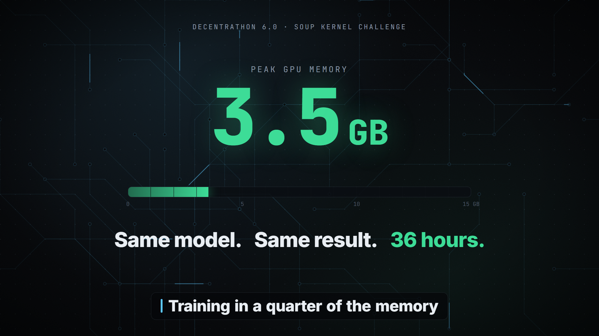
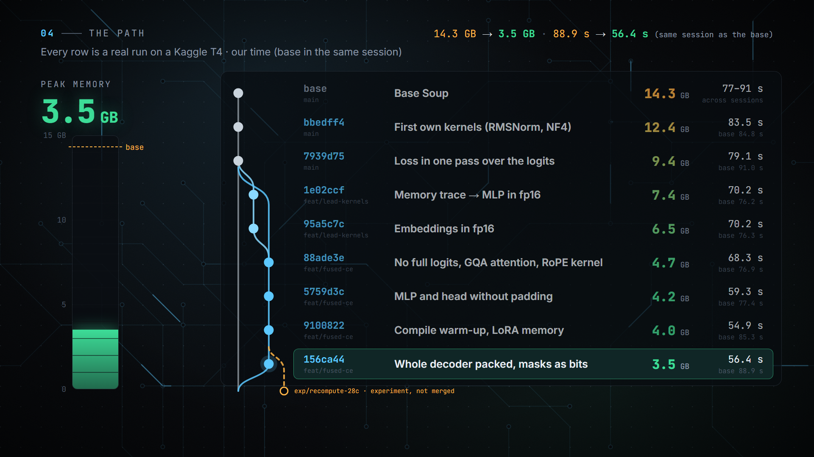

# QLoRA fine-tuning 1.6× faster and 4× lighter on a free GPU, with custom Triton kernels

**Decentrathon 6.0 (Astana Hub + BAITC), case "Soup Kernel Challenge", October 30–31, 2026. Team of four, 36 hours.
My role: team lead and integrator.**

The task: make a fixed fine-tuning run of the [Soup](https://pypi.org/project/soup-cli/) library faster and lighter
on a free Kaggle **Tesla T4**, using our own **Triton** GPU kernels, without changing the training itself: same model,
data, batches, LoRA, optimizer and the same adapter quality, checked by 10 automatic rules.

| | Base | Ours | |
|---|---|---|---|
| Training run (`soup train`), s | 75.8 | **46.9** | **1.62× faster** |
| Peak GPU memory, MiB | 14,345 | **3,531** | **4.06× less** |
| Eval loss | 2.04967 | 2.0495 | −0.008% (same quality) |
| Automatic rule checks | | **10 / 10** | own kernels: 14.2% of training time |

Final run: [public Kaggle notebook, saved version](https://www.kaggle.com/code/shakotan2/main-notebook?scriptVersionId=364295425)
(base and solution trained and measured in the same session).

---

## The setup

- **Model:** Qwen2.5-1.5B-Instruct, 4-bit NF4 quantization + LoRA (r=16 on q_proj/v_proj), i.e. QLoRA
- **Data:** 256 Kazakh instructions, batch 4, 64 steps
- **Hardware:** one Kaggle T4 (15 GB, Turing: fp16 only, no bf16)
- **Rules:** only our own `@triton.jit` kernels (no Unsloth, Liger, FlashAttention or other kernel libraries),
  they must take ≥ 5% of the training time, and the run must stay the same task: identical token counts,
  loss curve within 1–3%, the library's own metrics and logs within 3%, 79 regression tests passing
- **Scoring:** speed and memory relative to the best team (log scale), plus documentation

## How we approached it

**1. Measure first.** Before writing any kernel I profiled a training step on the T4. The surprise: matrix
multiplies were only ≈ 40% of GPU time. The rest was overhead: ≈ 17% fp16↔fp32 copies (the 4-bit layers cast
every input and output), ≈ 10% tiny element-wise kernels, and the 151,936-token vocabulary's logits being read
≈ 20 times per step (loss, entropy, accuracy, logging), with several 1.2 GB fp32 copies.

**2. Find what sits in memory.** I wrote a small tool (`memory_peak.py`) on top of PyTorch's allocator history: it
lists every tensor alive at the peak with the line of code that allocated it. It found two things nobody expected:

- **3.9 GB of MLP activations stored in fp32** because a 4-bit layer returns its fp16 result in its input's dtype.
  Casting the MLP input to fp16 once: 9,423 → 7,363 MiB.
- **fp32 embeddings plus an fp16 copy for the tied output head** (≈ 1.3 GB). Restoring fp16 embeddings when it is
  exact: 7,363 → 6,483 MiB.

**3. Kernels where the profile pointed.** Eight Triton kernels run in every training step:

| Kernel | What it replaces |
|---|---|
| RMSNorm forward / backward | the norm's fp32 casts and its pow / mean / rsqrt / mul as separate kernels, both ways |
| NF4 dequantization | bitsandbytes' two launches per weight; one pass, bit-exact with bitsandbytes |
| Cross-entropy stats + gradient | the full `[4 × 512 × 151,936]` logits: online softmax over 128-row chunks gives loss, entropy and argmax in one pass; the gradient is written over the chunk |
| RoPE | rotary embedding in fp32 registers, q and k in one launch |
| Dropout mask pack / unpack | LoRA dropout masks stored as bits, 8 per byte |

**4. Stop computing on padding and on Python.** The whole decoder runs on the real tokens packed into one sequence
(variable-length attention; rows of different batches are never mixed, as the rules require), and each layer's
attention and MLP became a single autograd function, which cut the time the GPU waits for Python from 307 to
203 ms per step.

*Every row is a real Kaggle run with the base measured in the same session (the image shows the history up to the
packed decoder; the final stage added the fused blocks and the faster NF4 kernel: 46.9 s, 3,531 MiB).*

## A decision I'm glad we measured

The last optimization stage gave us two modes: **speed** (1.57–1.62×, 3.5 GB) or **memory** (2.2 GB, 6.5× less
than the base, about the level of Unsloth on this task, ≈ 2.3 GB per the organizers, but only 1.39× faster).
The instinct was "take the impressive memory number". Instead I put both into the scoring formula
(`35·ln s / ln s_best + 30·ln m / ln m_best`). Speed has a hard ceiling here (≈ 21 s of every run is model loading
and exit that no one may touch, so by our estimate no run can go much past ≈ 1.85×), which makes every 0.1× of
speed worth more points than the same relative gain in memory. Under the assumptions we could make about other
teams the speed mode scored equal or higher, so we submitted it and kept memory as a documented switch in the code.

## What didn't work (and that's part of the result)

- An NF4 dequantization fused **inside** the matmul (our own Triton GEMM): correct, but 15–35× slower than
  dequantization + cuBLAS on a T4.
- Fusing the residual add into RMSNorm: 1.381× vs 1.379×, inside the noise, +40 MiB. Reverted.
- Removing CPU↔GPU syncs and keeping metrics on the GPU: no measurable change. Reverted.
- Measurement noise was the real enemy: the same base code took 76–91 s on different Kaggle machines, so we only
  ever compared base and solution from the same session, and used A/B/B/A ordering for small effects.

## My part

As team lead (role 1) I:

- profiled the baseline and built `memory_peak.py`, which found ≈ 2.9 GB of savings (MLP and embeddings in fp16);
- wrote the first kernels (RMSNorm, NF4 dequantization, the one-pass loss), which took the team to 10/10 checks on
  day one;
- ran every independent measurement on Kaggle, integrated the branches, chose the final mode with the scoring
  formula, and wrote the documentation, the submission and the demo video (Remotion).

My teammate **Anayat Ametov** did most of the later speed work: the chunked head, attention and RoPE changes, the packed
decoder, bit-packed masks, the fused blocks and the faster NF4 kernel. **Artur Vostrikov** worked on the math and
programming, **Artur Guturov** (captain) on rule checks, the presentation and the submission.

## Stack

Python · PyTorch 2.11 · **Triton 3.6** · CUDA (Tesla T4) · bitsandbytes (NF4) · PEFT / LoRA · TRL · transformers ·
PyTorch profiler and allocator history · Kaggle · Remotion (video)

## Links and sources

- Final run: [Kaggle notebook (public)](https://www.kaggle.com/code/shakotan2/main-notebook?scriptVersionId=364295425)
- Presentation: [slides](https://claude.ai/artifact/E1LpC2oRAi7pMCA1F7tMxk) (in Russian)
- Ideas we built on (code written by the team): online softmax (Milakov & Gimelshein, arXiv:1805.02867),
  Cut Cross-Entropy (Wijmans et al., arXiv:2411.09009), QLoRA (Dettmers et al., arXiv:2305.14314),
  RoFormer (Su et al., arXiv:2104.09864), FlashAttention's variable-length interface (Dao et al., arXiv:2205.14135),
  gradient checkpointing (Chen et al., arXiv:1604.06174), the Triton tutorials.

The solution code lives in the hackathon's team repository, which belongs to the organizers; this page describes
the work and links to its public results. AI assistants (Claude) helped with drafts and explanations; every change
was reviewed, tested against PyTorch / transformers / bitsandbytes references and measured on the T4.
